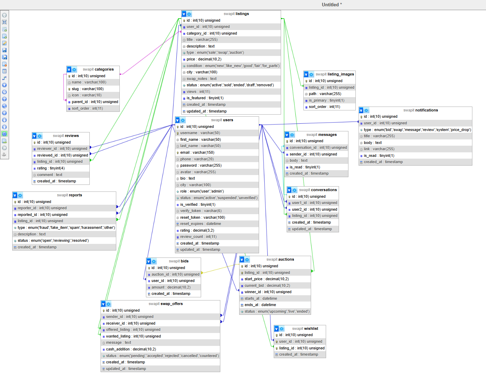

# 🔄 SwapIt — Buy. Sell. Swap. Bid.

> Jordan's smartest marketplace — trade fairly, swap freely, and bid on what you love.


---

## 📁 Project Structure

```
swapit/
│
├── 📂 ui-ux/                        # UI/UX Prototype (React JSX — design reference only)
│   ├── swapit-ui.jsx                # Full interactive prototype (16 screens)
│   └── README-UIUX.md               # How to run the UI prototype
│
├── 📂 public/                       # Web root (served by Apache/Nginx)
│   ├── 📂 css/
│   │   ├── main.css                 # Global styles + design tokens
│   │   ├── auth.css                 # Login, Register, Verify pages  [FE]
│   │   ├── listings.css             # Listing cards, browse, detail   [FE]
│   │   └── dashboard.css            # User dashboard pages             [FE]
│   ├── 📂 css/js/                   # JavaScript files (note: lives under css/ folder)
│   │   ├── main.js                  # Global JS utilities              [FE]
│   │   ├── auction.js               # Live auction countdown + bidding [FE]
│   │   ├── chat.js                  # Real-time messaging              [FE]
│   │   └── upload.js                # Image upload & preview           [FE]
│   └── 📂 images/
│       └── uploads/                 # Uploaded listing images (auto-created by upload.php)
│
├── 📂 src/
│   ├── 📂 config/                   # App configuration + shared utilities
│   │   ├── config.example.php       # Config template — copy to config.php and fill in values
│   │   ├── config.php               # ⚠ NOT in git — create from config.example.php
│   │   ├── database.php             # PDO DB connection — use db() helper function  [BE]
│   │   └── jwt.php                  # JWT helpers — createJWT() / verifyJWT()       [BE]
│   │
│   ├── 📂 config/includes/          # Reusable PHP layout partials
│   │   ├── header.php               # Navbar + <head>  [FE]
│   │   ├── footer.php               # Footer HTML      [FE]
│   │   └── sidebar.php              # Filter sidebar   [FE]
│   │
│   ├── 📂 config/components/        # Reusable PHP UI components
│   │   ├── listing-card.php         # Single listing card HTML  [FE]
│   │   ├── pagination.php           # Pagination controls       [FE]
│   │   └── toast.php                # Toast notification        [FE]
│   │
│   ├── 📂 config/pages/             # All frontend page files   [FE — write your code here]
│   │   ├── login.php
│   │   ├── register.php
│   │   ├── verify.php
│   │   ├── forgot-password.php
│   │   ├── home.php
│   │   ├── browse.php
│   │   ├── listing-detail.php
│   │   ├── create-listing.php
│   │   ├── edit-listing.php
│   │   ├── auction.php
│   │   ├── messages.php
│   │   ├── chat.php
│   │   ├── profile.php
│   │   ├── edit-profile.php
│   │   ├── my-listings.php
│   │   ├── my-orders.php
│   │   ├── my-bids.php
│   │   ├── swap-offers.php
│   │   ├── wishlist.php
│   │   ├── notifications.php
│   │   ├── reviews.php
│   │   ├── search.php
│   │   ├── 📂 admin/
│   │   │   ├── dashboard.php
│   │   │   ├── users.php
│   │   │   ├── listings.php
│   │   │   └── reports.php
│   │   └── 404.php
│   │
│   ├── 📂 config/api/               # Backend API endpoints     [BE — write your code here]
│   │   ├── auth.php                 # Login / Register / Logout / Forgot+Reset password  (implemented)
│   │   ├── listings.php             # CRUD for listings
│   │   ├── bids.php                 # Place / get auction bids
│   │   ├── close_auctions.php       # Cron Job: Auto-close expired auctions               (implemented)
│   │   ├── swaps.php                # Swap offer actions
│   │   ├── messages.php             # Send / receive messages
│   │   ├── upload.php               # Image upload handler
│   │   ├── wishlist.php             # Save / remove wishlist items
│   │   ├── notifications.php        # User notifications
│   │   ├── reviews.php              # User reviews + ratings
│   │   ├── categories.php           # Listing categories (for dropdowns/filters)
│   │   └── admin.php                # Admin-only actions
│   │
│   └── 📂 helpers/                  # Shared backend utilities  [BE]
│       └── api.php                  # jsonResponse(), jsonError(), requireAuth(), requireAdmin()
│
├── 📂 database/
│   ├── schema.sql                   # Full DB schema (CREATE TABLES — 12 tables)
│   └── seed.sql                     # Sample/demo data
│
├── .htaccess                        # URL rewriting (Apache)
├── .gitignore
└── README.md                        # This file
```

---

## 🎨 Design System

| Token | Value |
|-------|-------|
| Primary Green | `#2C6E49` |
| Secondary Green | `#40916C` |
| Orange Accent | `#E76F51` |
| Background Cream | `#F8F4EE` |
| Dark Navy | `#1A1A2E` |
| Font Display | Syne (700, 800) |
| Font Body | DM Sans (400, 500, 600) |

> 📐 See `ui-ux/swapit-ui.jsx` for full interactive prototype with all 15 screens.

---

## 🚀 How to Run (Local Development)

### Requirements
- PHP 8.1+
- MySQL 8.0+
- Apache or Nginx (or use XAMPP/MAMP/Laragon)

### Step 1 — Clone the repo
```bash
git clone https://github.com/YOUR_USERNAME/swapit.git
cd swapit
```

### Step 2 — Set up the database
```bash
# Open MySQL and run:
mysql -u root -p
CREATE DATABASE swapit;
USE swapit;
SOURCE database/schema.sql;
SOURCE database/seed.sql;
```

### Step 3 — Configure the app
```bash
# Copy and edit the config file
cp src/config/config.example.php src/config/config.php
# Edit config.php with your DB credentials
```

### Step 4 — Start a local server

**Option A — PHP built-in server (simplest):**
```bash
cd public
php -S localhost:8000
```
Then open `http://localhost:8000`

**Option B — XAMPP/MAMP:**
- Copy the project to your `htdocs` folder
- Start Apache + MySQL
- Open `http://localhost/swapit/public`

**Option C — Laragon (recommended for Windows):**
- Drop the project in `C:/laragon/www/swapit`
- Start Laragon
- Open `http://swapit.test`

---


## 🗄 Database Tables

| Table | Description |
|-------|-------------|
| `users` | User accounts, profiles, roles |
| `listings` | All item listings (sale/swap/auction) |
| `bids` | Auction bid history |
| `swap_offers` | Swap proposals between users |
| `messages` | Chat messages between users |
| `conversations` | Message threads |
| `wishlist` | Saved/favourited listings |
| `reviews` | User ratings and reviews |
| `notifications` | User notification records |
| `reports` | User-submitted reports |
| `categories` | Item categories |
| `images` | Listing image paths |

---

## 🖥 Pages

| Page | File | Description |
|------|------|-------------|
| Login | `pages/login.php` | User sign in |
| Register | `pages/register.php` | New account creation |
| Verify Email | `pages/verify.php` | OTP email verification |
| Forgot Password | `pages/forgot-password.php` | Password reset flow |
| Home | `pages/home.php` | Landing + featured listings |
| Browse | `pages/browse.php` | All listings with filters |
| Listing Detail | `pages/listing-detail.php` | Single item page |
| Create Listing | `pages/create-listing.php` | Post new item |
| Auction | `pages/auction.php` | Live auction with countdown |
| Messages | `pages/messages.php` | Inbox |
| Chat | `pages/chat.php` | Conversation thread |
| Profile | `pages/profile.php` | Public user profile |
| My Listings | `pages/my-listings.php` | Manage own listings |
| Swap Offers | `pages/swap-offers.php` | Incoming/outgoing swaps |
| Wishlist | `pages/wishlist.php` | Saved items |
| Notifications | `pages/notifications.php` | All notifications |
| Admin Dashboard | `pages/admin/dashboard.php` | Admin overview |
| Admin Users | `pages/admin/users.php` | User management |
| 404 | `pages/404.php` | Not found page |

---

## 🔌 API Endpoints

All endpoints live in `src/config/api/`. Include `src/helpers/api.php` for shared utilities.

| Method | Endpoint | Auth | Description |
|--------|----------|------|-------------|
| POST | `/api/auth.php?action=login` | — | User login |
| POST | `/api/auth.php?action=register` | — | User registration |
| POST | `/api/auth.php?action=logout` | — | Logout |
| GET | `/api/listings.php` | — | Browse / search listings |
| GET | `/api/listings.php?id=X` | — | Single listing detail |
| POST | `/api/listings.php` | JWT | Create listing |
| PUT | `/api/listings.php?id=X` | JWT | Update listing (owner) |
| DELETE | `/api/listings.php?id=X` | JWT | Remove listing (owner/admin) |
| GET | `/api/bids.php?listing_id=X` | — | Get bids for auction |
| POST | `/api/bids.php` | JWT | Place a bid |
| GET | `/api/swaps.php` | JWT | Get user's swap offers |
| POST | `/api/swaps.php` | JWT | Send swap offer |
| PUT | `/api/swaps.php?id=X` | JWT | Accept / reject / counter swap |
| GET | `/api/messages.php` | JWT | List conversations |
| GET | `/api/messages.php?conv_id=X` | JWT | Get messages in conversation |
| POST | `/api/messages.php` | JWT | Send message |
| POST | `/api/upload.php` | JWT | Upload listing image(s) |
| GET | `/api/wishlist.php` | JWT | Get wishlist |
| POST | `/api/wishlist.php` | JWT | Add to wishlist |
| DELETE | `/api/wishlist.php?listing_id=X` | JWT | Remove from wishlist |
| GET | `/api/notifications.php` | JWT | Get notifications |
| PUT | `/api/notifications.php?id=X` | JWT | Mark notification as read |
| PUT | `/api/notifications.php?action=mark_all` | JWT | Mark all as read |
| GET | `/api/reviews.php?user_id=X` | — | Get reviews for a user |
| POST | `/api/reviews.php` | JWT | Submit a review |
| DELETE | `/api/reviews.php?id=X` | JWT | Delete a review |
| GET | `/api/categories.php` | — | List all categories |
| GET | `/api/admin.php?action=stats` | Admin | Dashboard stats |
| GET | `/api/admin.php?action=users` | Admin | Manage users |
| PUT | `/api/admin.php?action=user&id=X` | Admin | Update user status |
| GET | `/api/admin.php?action=reports` | Admin | View reports |
| PUT | `/api/admin.php?action=report&id=X` | Admin | Update report status |
| — | `/api/close_auctions.php` | Cron | Auto-close expired auctions & pick winners |

---

## ⚙️ Automation (Cron Jobs)

To ensure auctions close exactly when they expire, configure a cron job on the server:

```bash
# Run every minute — processes all expired auctions automatically
* * * * * php /path/to/project/src/config/api/close_auctions.php >> /var/log/close_auctions.log 2>&1
```

---

## 🎨 UI/UX Prototype

The `ui-ux/` folder contains the full interactive prototype built in React JSX.

### How to run the prototype:
```bash
cd ui-ux
npm install
npm run dev
# Open http://localhost:5173
```

> This is for **design reference only** — it shows all 15 screens with working interactions, animations, and navigation. The actual project is built in PHP.

---

## 🔐 Default Admin Credentials (dev only)

| Field | Value |
|-------|-------|
| Email | `admin@swapit.jo` |
| Password | `Admin@1234` |

---

## 📄 License

MIT © 2025 SwapIt
